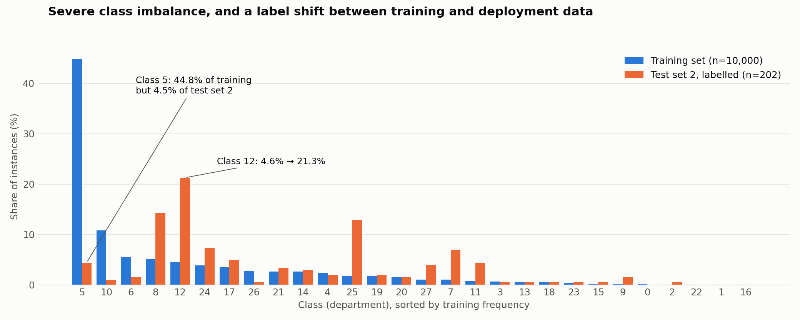

# Customer Feedback Classification

Routing customer comments to the right department with machine learning. Each comment is a 300-dimensional NLP feature vector, and the task is to assign it to one of **28 product departments**, despite extreme class imbalance and a shift in the data once the model is deployed.

> UNSW COMP9417 Machine Learning and Data Mining group project (Term 1, 2025). This repository contains my notebooks for class imbalance, outlier removal, resampling and distribution shift detection.



*The largest class (5) holds 44.8% of the training data, and the four smallest have only 6 to 7 examples each, a **746 : 1** imbalance. In the deployment data (test set 2) the mix changes sharply: class 5 drops to 4.5% while class 12 rises from 4.6% to 21.3%.*

---

## The problem

| Dataset | Size | Labels |
|---|---|---|
| Training set | 10,000 comments × 300 features | All labelled |
| Test set 1 | 1,000 comments | Unlabelled |
| Test set 2 (deployment data) | 2,020 comments | 202 labelled, 1,818 unlabelled |

Two things make this hard:

1. **Class imbalance.** A model can score high accuracy by predicting the majority class, so models are compared on **macro F1**, which weights every department equally.
2. **Distribution shift.** After deployment, departments started receiving messages unrelated to them. Test set 2 was created to diagnose why.

## Approach

1. **Stratified train/validation split** (80/20), so every class, including those with 6 to 7 examples, appears in validation.
2. **Exploratory analysis with SQL and PCA.** Label distributions were queried with SQLite, and a 2D PCA projection was used to see how each class sits relative to the others, which classes overlap, and where outliers lie.
3. **Outlier removal with Isolation Forest.** One Isolation Forest was trained per class (1% contamination), applied only to classes with at least 50 examples so rare classes keep every point.
4. **Dimensionality reduction.** PCA to 50 components (74% of variance retained) before resampling, because SMOTE relies on Euclidean nearest neighbours, which break down in 300 dimensions.
5. **Resampling strategies**, each generated as its own dataset:
   - **SMOTE-Tomek:** a two-stage SMOTE (k = 3 neighbours for the 4 rarest classes, then mid-size classes up to 200 or 500), followed by Tomek links to remove ambiguous points on class boundaries
   - **SMOTE-Tomek + random undersampling** of the majority class
   - **Fully balanced:** every class resampled to a similar size
6. **Comparison with k-nearest neighbours** on the validation set, using macro F1 and per-class precision and recall.
7. **Distribution shift detection.** Maximum Mean Discrepancy (MMD) with an RBF kernel, computed on a shared 50-component PCA space, comparing the training data against test set 2.

## Results

**Resampling (kNN, k = 5, validation set of 1,978 comments after outlier removal)**

| Training data | Accuracy | Macro F1 |
|---|---|---|
| PCA only (no resampling) | 0.512 | 0.078 |
| PCA + SMOTE-Tomek | 0.455 | 0.089 |
| PCA + SMOTE-Tomek + undersampling | 0.402 | **0.091** |

Resampling raised macro F1 by up to **17%**, while accuracy fell, because the model stopped defaulting to the majority class. It improved recall on minority classes at the cost of class 5 (recall 0.97 → 0.76). The kNN results are a quick comparison of the datasets, not the final model.

**Distribution shift.** The MMD between the training data and test set 2 was **0.0118**, above the 0.01 detection threshold, so a shift was confirmed. Comparing labels (figure above) shows that much of it is **label shift**: the proportion of each department changes sharply, even though the comments are represented in the same feature space.

## Repository contents

| Path | What it contains |
|---|---|
| `notebooks/01_train_validation_split.ipynb` | Stratified 80/20 split of the training data |
| `notebooks/02_class_imbalance_smote_tomek.ipynb` | Label distribution queries, 2D PCA plots of every class, outlier inspection, and step-by-step SMOTE and Tomek links |
| `notebooks/03_pca_resampled_datasets.ipynb` | Isolation Forest, scaling and 50-component PCA, then the SMOTE-Tomek, undersampled and balanced datasets |
| `notebooks/04_isolation_forest_resampled_datasets.ipynb` | Same resampling pipeline on a subset of 19 selected features, without PCA |
| `notebooks/05_knn_resampling_comparison.ipynb` | kNN trained on each resampled dataset, with per-class reports and macro F1 |
| `notebooks/06_distribution_shift_eda.ipynb` | Label distributions and a shared PCA projection of the training data and test set 2 |
| `notebooks/07_mmd_shift_detection.ipynb` | MMD-based shift detection |
| `data/` | Original data: `X_train.csv`, `y_train.csv`, `X_test_1.csv`, `X_test_2.csv` and `y_test_2_reduced.csv` (labels for the 202 labelled test set 2 points) |
| `images/` | Figures used in this README |

## Running the notebooks

```bash
pip install -r requirements.txt
jupyter notebook notebooks/
```

Run the notebooks in order. Notebook 01 creates the train/validation split, and notebooks 03 and 04 write the resampled datasets into `data/` for notebook 05. Those generated files are not committed, because they can be recreated and add about 90MB. Some file names differ between notebooks 03 and 05 (for example, notebook 05 reads `X_pca2_train.csv`, which notebook 03 saves as `X_pca_train.csv`), so check the names in notebook 05 before running it.
